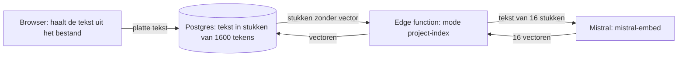
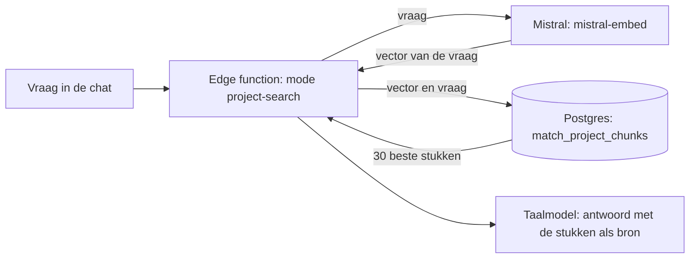

<p align="center">
  
</p>

<p align="center">
  Prompts bouwen, bewaren, delen en meteen uitproberen, voor medewerkers van de Nederlandse rijksoverheid.
</p>

<p align="center">
  <a href="https://www.promptplein.app">www.promptplein.app</a>
</p>

---

## Wat is PromptPlein?

Een goede prompt schrijven kost tijd, en wat een collega al heeft uitgezocht blijft vaak bij die collega. PromptPlein brengt dat samen op één plek. De app heeft twee kanten:

- **De promptbouwer** schrijft met AI een herbruikbare prompt. Je vertelt wat je wilt, de AI kiest de techniek en vult de opdracht uit.
- **De chat** draait die prompt meteen, zodat je ziet wat hij oplevert. Een prompt gaat met één knop van de bouwer naar de chat en weer terug.

De hele interface is Nederlands.

## Wat je ermee kunt

| Onderdeel | Wat het doet |
| --- | --- |
| **Prompt maken** (`/genereren`) | De AI analyseert je vraag en kiest de techniek. Met een stappenplan, vragen vooraf en een controle van je aannames. |
| **Testkamer** | Bouwen, testen en verbeteren in een gesloten lus, met versies. |
| **Technieken** (`/technieken`) | Oefenpagina: kies zelf een techniek en vul de velden in. |
| **Chat** (`/chat`) | Werkt zonder account. Met projecten, bijlagen, dicteren en optioneel zoeken op internet. |
| **Bibliotheek en community** | Prompts bewaren, zoeken en delen, met een goedkeuringsstroom per zichtbaarheidsniveau. |
| **Organisatienetwerk** (`/netwerk`) | Organisaties als boom van ministeries. |
| **Beheer** (`/admin`) | Gebruikers, moderatoren, categorieën, analytics, auditlog en het bewerken van de systeemprompts. |

## Privacy

- **Chatgesprekken staan niet op de server.** Ze blijven in de browser (`localStorage`), horen bij het apparaat en verdwijnen pas als je ze verwijdert of je browsergegevens wist. Berichten gaan wel via de server naar het taalmodel om een antwoord te krijgen.
- **Zoeken op internet kan via een eigen server.** Met [SearXNG](infra/searxng/README.md) gaat alleen de zoekvraag naar buiten en ziet geen externe zoekdienst wie hem stelt.
- **Taalmodel.** De AI-laag draait op Mistral, een Europese aanbieder.
- **Toegang** wordt afgedwongen in de database met Row Level Security, niet in de frontend.
- **Bronbestanden in projecten** staan als tekst in de database. Voor het toevoegen zoekt de browser naar persoonsgegevens en biedt aan ze te vervangen. Alleen in een groot project gaat de tekst ook naar Mistral om hem doorzoekbaar te maken, zie hieronder.
- **Bewaartermijn.** Van een project dat drie maanden niet is gebruikt, worden de bronbestanden verwijderd. Het project zelf blijft staan. Een week vooraf krijgt de eigenaar een mail met een knop om de bestanden te bewaren; die keuze wordt vastgelegd. In de back-ups van Supabase blijven de bestanden nog staan tot die verlopen.
- **Edge functions in de EU.** Elke aanroep vraagt om de regio `eu-west-1` (Ierland), naast de database, ook als de gebruiker buiten Europa werkt.

## Zoeken in de bronbestanden van een project

In een chatproject zet je bronbestanden (`.txt`, `.md`, `.pdf`, `.docx`). De chat gebruikt ze als bron bij elk antwoord.

- **Kleine projecten**, tot 200.000 tekens samen, gaan bij elke vraag in hun geheel mee. Er wordt dan niets gezocht.
- **Grote projecten** passen niet in één vraag. Dan gaan alleen de 30 stukken mee die het best bij de vraag passen. De vorige vraag telt mee, want een vervolgvraag zegt op zichzelf te weinig.

Die stukken worden op twee manieren tegelijk gezocht:

- op **betekenis**, met vectoren: een vraag over "vakantiedagen" vindt ook een stuk over "verlof";
- op **woorden**, met de Nederlandse tekstzoeker van Postgres: die vindt exacte termen zoals een zaaknummer of wetsartikel juist beter.

### Bestand toevoegen



1. **Uitlezen.** De browser haalt de platte tekst uit het bestand. Het originele bestand gaat nergens heen.
2. **Controle op persoonsgegevens.** Nog in de browser zoekt PromptPlein naar BSN's (met de elfproef), namen met een aanhef of veldnaam ("de heer Jansen", "Naam: Jan de Vries"), e-mailadressen, telefoonnummers, IBAN's en geboortedata. Staat er iets in, dan kies je: vervangen door een plaatshouder zoals `[BSN]`, toch toevoegen, of niet toevoegen. Een naam zonder aanhef vindt deze controle niet. Beheer zet de controle aan of uit, samen met die voor de chat.
3. **Opslaan.** Alleen de tekst gaat naar de database (`chat_project_files`).
4. **Opknippen.** Een trigger in Postgres knipt de tekst in stukken van hoogstens 1600 tekens (`chat_project_file_chunks`) en maakt er een woordindex bij.
5. **Vectoren maken, alleen in een groot project.** Pas als de bestanden samen boven de 200.000 tekens komen, maakt de edge function `optimize-prompt` (mode `project-index`) de stukken doorzoekbaar: hij stuurt ze in porties van 16 naar `mistral-embed`. Een klein project zoekt nooit, dus daar gaat de tekst hiervoor niet naar Mistral. De grens staat ook in de function zelf, zodat hij niet van de browser afhangt. Mistral geeft per stuk een vector terug: een reeks van 1024 getallen die de betekenis van de tekst vastlegt.
6. **Vectoren opslaan.** De function schrijft de vectoren in de kolom `embedding` van dezelfde tabel. Daarvoor draait de extensie `pgvector` in Supabase; er is geen aparte vectordatabase.

Het verwerken start zodra een project over de grens gaat, in de projectinstellingen. Wordt het onderbroken, dan maakt de eerste vraag in dat project het af. Die vraag wacht daar hoogstens 20 seconden op en zoekt daarna toch, met de woordzoeker voor wat nog geen vector heeft.

### Vraag stellen



1. Van de vraag wordt ook een vector gemaakt, met hetzelfde model.
2. De databasefunctie `match_project_chunks` zoekt binnen het project de 100 stukken die qua betekenis het dichtst bij de vraag liggen, en de 100 die het best op de woorden passen.
3. De twee lijsten gaan samen op hun plek in de ranglijst (reciprocal rank fusion), niet op hun score: een afstand en een tekstscore zijn niet met elkaar te vergelijken.
4. De 30 beste stukken gaan als bron mee naar het taalmodel. Onder het antwoord staat uit welke bestanden ze komen.

Er is bewust geen HNSW- of IVFFlat-index. Die zoeken eerst over alle projecten en filteren pas daarna op project, waardoor treffers binnen één project kunnen wegvallen. Binnen één project exact vergelijken is snel genoeg.

Valt Mistral uit, dan zoekt de app alleen op woorden. Niemand raakt zijn bronnen kwijt.

### Wat er waar staat

| Wat | Waar |
| --- | --- |
| Het originele bestand | Alleen in de browser, tijdens het uitlezen |
| De tekst, de stukken en de vectoren | Postgres in Supabase, regio West-EU (Ierland) |
| De tekst van elk stuk, in een groot project | Gaat naar Mistral om de vector te berekenen |
| Wat je bij de controle laat vervangen | Nergens, het wordt in de browser vervangen |
| De vraag, en de stukken die meegaan | Gaan naar Mistral voor de vector en het antwoord |
| Het gesprek zelf | Alleen in de browser |

Een vector is geen anonieme versie van de tekst. Met de juiste technieken is een deel van de oorspronkelijke tekst eruit terug te halen. Behandel de vectoren dus net zo zorgvuldig als de tekst zelf.

### Beveiliging

- **Alles loopt met het token van de gebruiker**, niet met een beheerderssleutel. Row Level Security bepaalt dus ook hier wat iemand ziet: alleen de eigenaar van een project kan de stukken lezen, doorzoeken of er vectoren bij zetten.
- **Alleen de vector is wijzigbaar.** Van de stukken mag de eigenaar alleen de kolom `embedding` vullen. De tekst kan niemand achteraf aanpassen.
- **De zoekfuncties draaien onder de rechten van de aanroeper** (`SECURITY INVOKER`) en zijn zonder account niet aan te roepen.
- **Verwijderen ruimt alles op.** Verdwijnt een bestand, project of account, dan verdwijnen de stukken en vectoren mee (`ON DELETE CASCADE`).
- **Opruimen na drie maanden.** Een geplande taak (`pg_cron`, `projecten-opruimen`) waarschuwt elke nacht per mail wat over een week aan de beurt is en verwijdert de bronbestanden van projecten die een week eerder zijn gewaarschuwd (0053, `chat_project_retention_log`). Gebruik is: het project openen, de instellingen openen of er een vraag in stellen (`mark_chat_project_used`).
- **Geen tekst in de logs.** De function logt bij een fout alleen de foutmelding, nooit de inhoud van een bestand.
- **Ander embeddingmodel, alle vectoren opnieuw.** Vectoren van twee modellen zijn niet met elkaar te vergelijken.

## Techniek

| Laag | Keuze |
| --- | --- |
| Frontend | React 18, TypeScript, Vite 6 |
| Styling | Tailwind CSS in de Rijkshuisstijl, met licht en donker thema |
| 3D en grafieken | react-three-fiber, three.js, recharts |
| Backend | Supabase: Postgres met RLS, Auth, Storage, Edge Functions (Deno) |
| AI | Mistral, via de edge function `optimize-prompt` |
| Zoeken in bronnen | `pgvector` in Postgres, vectoren van `mistral-embed` |
| Hosting | Vercel |

## Zelf draaien

Je hebt Node.js (actuele LTS) nodig.

```bash
git clone https://github.com/PromptPlein/PromptPlein.git
cd PromptPlein
npm install
npm run dev
```

Zonder configuratie draait de app op een lokale proefopslag in de browser (`localStorage`), zodat je de interface kunt bekijken. Inloggen en de AI-functies hebben de backend hieronder nodig.

### Backend koppelen

Maak een eigen Supabase-project aan en zet een `.env` in de hoofdmap:

```bash
VITE_SUPABASE_URL=https://<jouw-project>.supabase.co
VITE_SUPABASE_ANON_KEY=<jouw-anon-key>
```

Zet daarna de database klaar en rol de functies uit:

```bash
supabase link --project-ref <jouw-project-ref>
supabase db push

supabase secrets set MISTRAL_API_KEY=<jouw-sleutel>
supabase functions deploy optimize-prompt
```

De referentiedata (rollen, categorieën, technieken) staat in `supabase/seed.sql` en `supabase/seed_phase2.sql`.

Optionele secrets van de functies:

| Secret | Waarvoor |
| --- | --- |
| `SEARXNG_URL`, `SEARXNG_TOKEN` | Zoeken in de chat via een eigen server, zie [infra/searxng](infra/searxng/README.md) |
| `TAVILY_API_KEY` | Zoeken via Tavily, als er geen eigen server is |
| `BREVO_API_KEY`, `CONTACT_FROM_EMAIL`, `CONTACT_TO_EMAIL` | Het contactformulier (functie `send-contact`) |
| `BREVO_API_KEY`, `BREVO_LIST_ID`, `BREVO_WEBHOOK_SECRET` | Nieuwe gebruikers aanmelden bij Brevo (functie `register-brevo-contact`) |

### Scripts

| Commando | Wat het doet |
| --- | --- |
| `npm run dev` | Ontwikkelserver |
| `npm run build` | Typecheck en productiebuild |
| `npm run preview` | Productiebuild lokaal bekijken |

## Projectstructuur

```
src/
  pages/        één bestand per route
  components/   interface per onderdeel
  services/     alle datatoegang, met een lokale tak voor de proefopslag
  context/      auth, referentiedata en thema
  lib/          hulpcode, zoals de chatopslag en de streaming
  config/       providers, modellen en prijzen
  types/        de domeinmodellen
supabase/
  functions/    optimize-prompt, send-contact, register-brevo-contact, brevo-event
  migrations/   databaseschema, oplopend genummerd
infra/
  searxng/      eigen zoekserver voor de chat
docs/           ontwerpnotities en archief
```

Nieuwe AI-functionaliteit komt als extra `mode` in de edge function `optimize-prompt`. De systeemprompts zijn te bewerken in Beheer, zonder nieuwe uitrol. De werkafspraken en de achtergrond van de architectuur staan in [CLAUDE.md](CLAUDE.md).

## Rechten

PromptPlein is open source onder de European Union Public Licence v. 1.2 (EUPL-1.2). Je mag de code gebruiken, aanpassen en verspreiden onder de voorwaarden in [LICENSE](LICENSE). Verspreid je een aangepaste versie of bied je die aan als dienst, dan valt die ook onder de EUPL.

Het lettertype Rijks Sans en het beeldmerk van de Rijksoverheid staan met toestemming in deze repository, omdat PromptPlein van de Rijksoverheid is. Ze vallen niet onder de EUPL-1.2. Die licentie geldt dus niet voor `src/assets/fonts/` en `public/logo-rijksoverheid.*`, en deze bestanden mogen niet worden overgenomen in andere producten.
